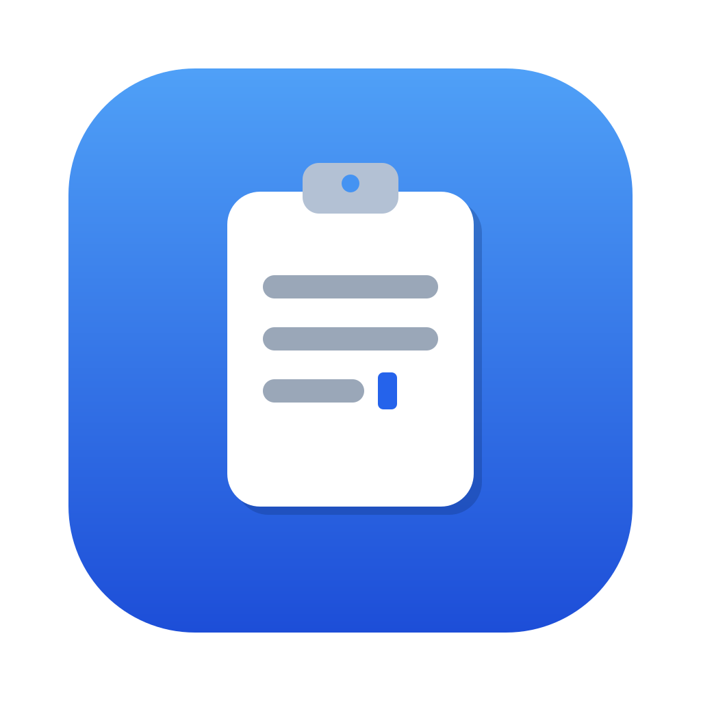

<p align="center"></p>

# cliptype

**简体中文** | [English](README.en.md)

`cliptype` 读取剪贴板中的文本，以模拟键盘输入的方式逐字符"打"到当前焦点位置，
用于 <kbd>Ctrl/Cmd</kbd>+<kbd>V</kbd> 失效的场景：远程桌面、VNC、虚拟机、
部分密码框、自助终端软件等。支持 **macOS**（原生应用 + CLI）、**Windows**
（托盘 + CLI）、**Linux**（CLI）；目前主要在 macOS 上验证。

- 两种发送方式：Unicode 文本事件（任意字符、不受输入法干扰）与真实键码
  （VNC / 远程控制台 / 虚拟机）
- 单次倒计时输入、常驻热键、状态栏 / 托盘三种运行模式
- macOS 原生应用：菜单栏常驻、热键自由录制、可选的本地剪贴板历史面板、应用内自动更新，
  界面中 / 英 / 日三语
- 剪贴板内容只在本机使用，不写入日志或错误信息；CLI 不联网

## 安装

安装包在 [GitHub Releases](https://github.com/Szyoo/cliptype/releases)。

| 平台 | 文件 | 说明 |
| --- | --- | --- |
| macOS 应用 | `cliptype-vX.Y.Z-macos-app-universal.zip` | 解压后把 **Cliptype.app** 拖入「应用程序」 |
| macOS CLI | `cliptype-vX.Y.Z-aarch64-apple-darwin.tar.gz` / `x86_64-apple-darwin` | Apple Silicon / Intel |
| Windows | `cliptype-vX.Y.Z-x86_64-pc-windows-msvc.zip` | 解压即用 |
| Linux | `cliptype-vX.Y.Z-x86_64-unknown-linux-gnu.tar.gz` | X11；运行时需要 `libxdo`（`sudo apt-get install -y libxdo3`） |

每个文件都附带 `.sha256` 校验文件。macOS 的应用和 CLI 都未经 Apple 公证，首次运行前
先清除隔离标记：

```sh
xattr -d com.apple.quarantine /Applications/Cliptype.app   # 应用
xattr -d com.apple.quarantine ./cliptype                   # CLI
```

预编译的 CLI 在 macOS / Windows 上含热键与托盘模式，Linux 上含热键模式。

**从源码构建**（需要 [Rust](https://rustup.rs/)；macOS 应用另需 Xcode 命令行工具；
Linux 需要 `libxdo-dev` 与 xcb 系列开发库）：

```sh
git clone https://github.com/Szyoo/cliptype && cd cliptype
cargo build --release                    # 仅单次模式
cargo build --release --features tray    # 含热键 + 托盘（macOS / Windows）
cargo build --release --features hotkey  # 含热键（任意平台）
scripts/bundle-macos.sh                  # macOS 应用 → dist/Cliptype.app
```

## 运行

### 权限

macOS 上模拟键盘输入需要**辅助功能**权限（系统设置 → 隐私与安全性 → 辅助功能），
授予对象是发起输入的那个应用：

| 运行方式 | 授权对象 | 授权后 |
| --- | --- | --- |
| Cliptype.app | **Cliptype**（内置引擎自动继承） | 重启 Cliptype |
| 终端运行 `cliptype` | 你使用的终端 App（Terminal / iTerm 等） | ⌘Q 完全退出终端后重开 |

未授权时 macOS 会静默丢弃按键；cliptype 会在输入前检测并报错退出。
从 0.1.2 及更早版本升级到 0.1.3+ 后若开关开着却不生效，需在辅助功能列表中选中
Cliptype 点 **−** 删除，再点 **+** 重新添加（应用会弹出这套引导）。
Windows 与 Linux 无需授权。

### macOS 应用

1. 打开 Cliptype，按首次启动的引导授予辅助功能权限。
2. 复制文本 → 聚焦目标输入框 → 按 <kbd>⌃⇧V</kbd>。
3. 剪贴板历史（设置中开启，默认关闭）：按 <kbd>⌃⇧H</kbd> 弹出面板，按 1–9 或 ↑↓ + 回车
   直接键入选中条目，⌘回车复制。历史只保存在本机。

热键、打字速度、远程控制台模式（VNC / 虚拟机）、历史面板位置与条数、自动检查更新
都在主窗口或菜单栏图标 → 设置中修改。

### CLI

```sh
cliptype --delay 3000            # 3 秒内切到目标窗口，剪贴板文本被打出
cliptype --mode keycode          # VNC / 远程控制台 / 虚拟机
cliptype --hotkey                # 常驻，每按一次 ctrl+shift+v 输入一次
cliptype --hotkey "alt+F9"       # 自定义组合键
cliptype --tray                  # 状态栏 / 托盘常驻（macOS / Windows）
echo -n "text" | cliptype --stdin
```

常驻模式会等修饰键松开后再输入；<kbd>Ctrl</kbd>+<kbd>C</kbd> 退出。

## 接口说明

### 命令行参数

| 参数 | 说明 | 默认 |
| --- | --- | --- |
| `-d, --delay <MS>` | 开始输入前的延迟（毫秒），用于切换到目标窗口；常驻模式下忽略 | `2000` |
| `-i, --interval <MS>` | 按键间隔（毫秒），0 为最快 | `0` |
| `-s, --speed <SPEED>` | 速度预设：`fast`（0 ms）/ `normal`（20 ms）/ `slow`（50 ms）；与 `--interval` 互斥 | — |
| `-m, --mode <MODE>` | `unicode`：Unicode 文本事件；`keycode`：按当前键盘布局发送真实键码（布局上没有的字符回退为 Unicode 并警告，发送期间临时切到英文输入源） | `unicode` |
| `--dry-run` | 只打印将要输入的内容，不实际输入 | — |
| `--stdin` | 从标准输入读取文本，代替剪贴板 | — |
| `--check-permission` | 不输入，仅以退出码返回是否允许模拟输入（0 = 允许，1 = 不允许） | — |
| `--hotkey [COMBO]` | 常驻热键模式（需 `hotkey` feature），如 `ctrl+shift+v`、`alt+F9` | `ctrl+shift+v` |
| `--tray` | 状态栏 / 托盘模式（需 `tray` feature，仅 macOS / Windows）；可与 `--hotkey` 组合指定热键 | — |
| `-h, --help` / `-V, --version` | 帮助 / 版本 | — |

剪贴板为空或非文本时提示后正常退出；出错时退出码非 0。

### 配置文件

托盘模式的设置保存在 `~/.config/cliptype/config.toml`（设置了 `XDG_CONFIG_HOME` 时
为 `$XDG_CONFIG_HOME/cliptype/`，Windows 为 `%APPDATA%\cliptype\`），一行一项：

```toml
interval_ms = 20
keycode_mode = false
```

macOS 应用的设置保存在应用自身的 UserDefaults 中；剪贴板历史保存在
`~/Library/Application Support/Cliptype/history.json`（权限 0600）。

## 许可证

[MIT](LICENSE)
